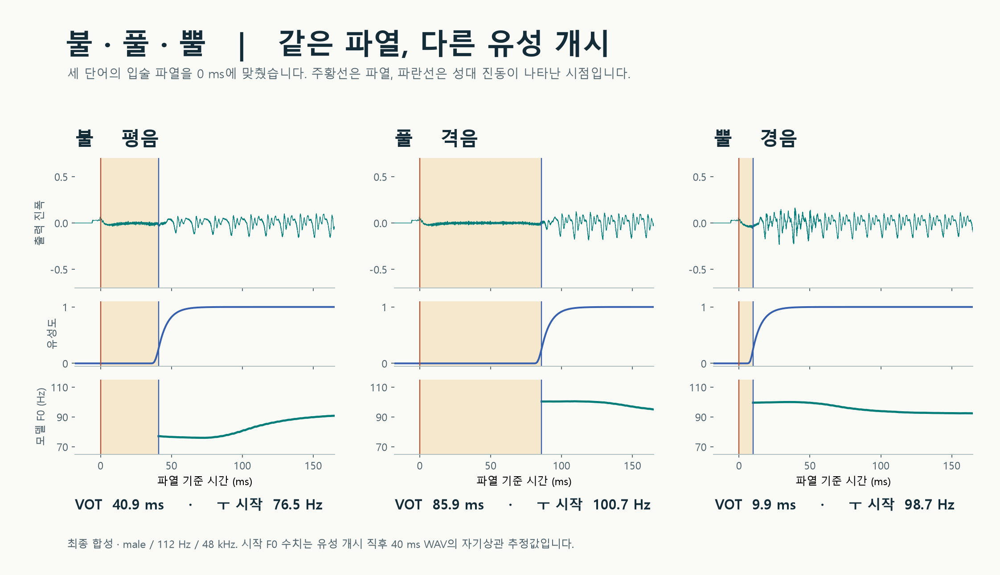
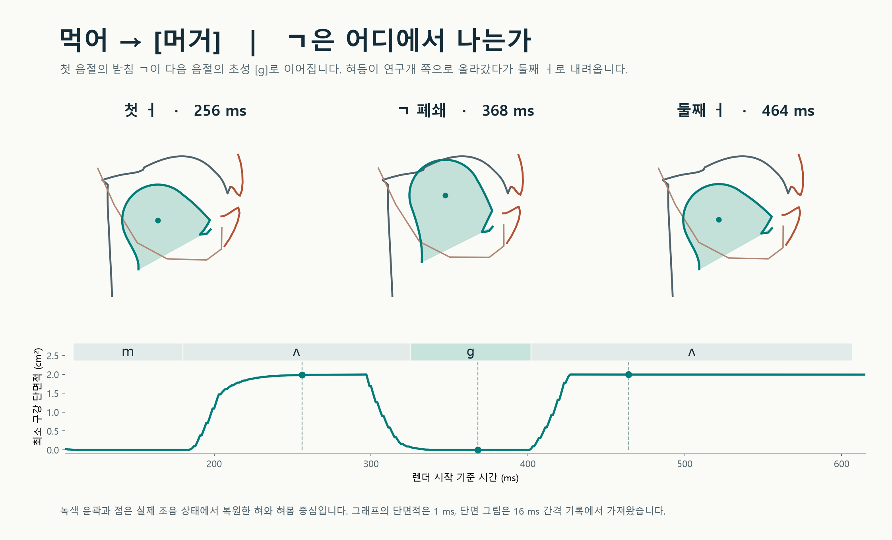

# CHIMERA 한국어 발화 실험

한글 문장을 CHIMERA의 혀·턱·입술·성대 모델로 합성했다. 여섯 단어에서 기존 VOT를 보존하면서 평음 뒤 모음의 시작 F0를 낮출 수 있었다. 경음 뒤의 성대 제어는 출력 WAV의 첫 두 배음 간 레벨 차이에도 나타났다. 한국어 화자의 단어 식별과 문장 자연스러움 평가는 남아 있다.

**비교 기준**은 upstream `1beb677f0ac5e94b32b87cd043f57e965e2fc2e7`이다. 포크의 `codex/korean-speech-lab`에서 `3f046b2`는 가사 발음을 말하기에 연결한 첫 기준선, `cb89d82`는 발음과 운율 실험을 구현한 커밋이다. [작업 브랜치](https://github.com/janghun-selvasai/chimera-vocal-synth/tree/codex/korean-speech-lab) · [원본 커밋](https://github.com/jamesondh/chimera-vocal-synth/commit/1beb677f0ac5e94b32b87cd043f57e965e2fc2e7)

## 직접 입력해서 발화하기

표준 발음 단어·짧은 문장 50개에서 최종 음소열이 맞은 항목은 29개에서 50개로 늘었다. 연음·겹받침·된소리되기·비음화의 전후 기호, 정답이던 WAV의 동일성, 목록 밖에서 재현한 두 오류를 항목별로 기록했다. [50항목 검토 결과](standard-50.md)

`/korean.html`의 **텍스트 읽기**에서 문장을 읽으면 같은 합성에서 얻은 성도 단면, 파형, F0와 음소 구간이 함께 움직인다. 시간축을 누르면 그 위치에서 멈추고 **여기서 재생**으로 이어 듣는다. 파열음 목록에서 자음을 선택해 구강 폐쇄가 풀리는 구간에서 파형으로 추정한 파열과 모델 유성 개시로 이동할 수 있다. 재개방을 찾지 못하면 계획 경계를 표시한다. 측정 위치를 옮기면 해당 인두·구강 단면의 압력 RMS와 기류를 읽는다.

두 탭의 **음색**에서 성인 남성·성인 여성·아동을 선택할 수 있다. 선택한 음색은 탭을 옮겨도 유지되며, 기준 피치는 CLI와 같은 112·205·285 Hz다. 발화 중 성도 안의 입자는 해당 모델이 계산한 기류를 따라 움직이고, 단면선의 밝기는 음압을 나타낸다. 단면 아래에서 입술 쪽 체적 기류(cm³/s)를 읽을 수 있다.

**애니메이션**의 **첫 입모양**에서 단어를 입력하면 가상 커서가 첫소리를 위한 조음점을 잡은 뒤 단어를 읽는다. **직접 조작**에서는 단면의 혀몸·혀끝·턱·입술·연구개·후두를 끌거나, 부위를 선택하고 단면에 초점을 둔 뒤 방향키로 움직인다. 날숨 강도와 자세를 바꿀 때마다 AudioWorklet의 물리 엔진이 소리를 합성한다. **공기의 여정**에서는 단어의 첫소리에서 첫 모음까지의 실제 렌더를 느리게 보며 성문에서 입술까지 관찰 위치를 옮긴다. 첫 입모양의 **발화 속도**는 준비를 마치고 단어를 말할 때 적용된다. 0.25~2배속으로 조절하면 음높이를 유지하면서 소리와 입 움직임이 같은 재생 시계를 따른다. 공기의 여정에는 별도의 경로 탐색 속도가 있다.

## 데모의 발음 기호 읽기

구절 첫머리의 ‘불, 풀, 뿔’은 각각 `p u l`, `pʰ u l`, `p͈ u l`이다. 위첨자 ʰ는 격음, 자음 아래의 두 획은 경음을 뜻한다. 두 표시는 합성에 사용한 성문 제어에서 가져온다. ‘저기 불’처럼 쉼 없이 이어 읽을 때는 모델이 ㅂ을 유성음으로 계획해 `b`가 표시된다.

| 구절 첫머리 | 평음 | 격음 | 경음 |
|---|---|---|---|
| 불 · 풀 · 뿔 | p | pʰ | p͈ |
| 달 · 탈 · 딸 | t | tʰ | t͈ |
| 굴 · 쿨 · 꿀 | k | kʰ | k͈ |
| 자 · 차 · 짜 | tɕ | tɕʰ | tɕ͈ |
| 살 · 쌀 | s | — | s͈ |
| 시 · 씨 | ɕ | — | ɕ͈ |

‘ㅅ·ㅆ’ 대조는 `clear`와 `adducted`에 들어 있다. 데모의 한글 발화에는 `adducted`를 상시 적용한다. 과거 비교용 조건에서 두 자음의 제어를 같게 계획했다면 두 자음은 같은 기호로 표시된다. 기존 CLI 렌더를 불러올 때는 파일에 남은 제어값과 타임라인이 일치해야 기호를 복원한다.

현대 한글 음절 11,172개를 단독과 ‘아’ 뒤에서 발음 기호 기댓값과 대조한다. 여기에 어절 단위 검사를 더해 같은 글자가 문맥에 따라 다른 소리를 내는 경우도 확인한다.

‘읽고’는 `i l k͈ o` [일꼬], ‘닭과’는 `t a k k͈ w a` [닥꽈]이다. 말하기와 노래 가사 모두 ㄺ으로 끝나는 용언 어간 12개의 마지막 음절을 식별한다. 같은 어절에서 ㄱ이 뒤따르면 ㄹ을 남기고 다음 초성을 ㄲ으로 만든다. ‘맑게[말께]’나 ‘긁개[글깨]’에도 같은 규칙이 적용된다. 명사 ‘닭·흙·칡’은 일반 겹받침 규칙을 따른다. 이 방식이 다루는 범위는 등록한 어간과 그 결합형이다. [국립국어원 제11항 해설](https://www.korean.go.kr/front/onlineQna/onlineQnaView.do?mn_id=73&pageIndex=1&qna_seq=334141)

‘읽어[일거]·읽는[잉는]·읽다[익따]’는 뒤에 오는 소리에 따라 갈린다. 어간 뒤의 ‘-히-’와 그 준말에서는 ㄹ이 남고 ㄱ과 ㅎ이 합쳐져, ‘읽히다[일키다]·읽혀[일켜]·긁힌[글킨]’으로 발음한다. 음성 합성 검사는 각 단어와 그 표준 발음을 한글로 풀어 쓴 입력을 같은 음색과 속도로 렌더해 WAV를 대조한다. [한국어기초사전 ‘읽다’](https://krdict.korean.go.kr/eng/dicSearch/SearchView?ParaWordNo=68752) · [‘읽히다’](https://krdict.korean.go.kr/eng/dicSearch/SearchView?ParaWordNo=73103)

## ㅅ·ㅆ 발음과 세 음색

**음색 비교** 탭에서 같은 단어나 문장을 성인 남성·성인 여성·아동 프리셋으로 합성한다. 모음 하나를 선택하면 같은 시점의 성도 단면을 같은 축척으로 그린다. 듣기를 누르면 선택한 음색의 단면만 움직인다. 슬라이더로 위치를 옮기면 그 지점부터 비교할 수 있다.

| ‘아’의 모음 중앙 | 성대 진동 F0 | 인두 + 구강 길이 | 성도 공명 F1 / F2 |
|---|---:|---:|---:|
| 성인 남성 | 92 Hz | 8.32 + 7.63 cm | 719 / 1454 Hz |
| 성인 여성 | 169 Hz | 6.55 + 6.95 cm | 821 / 1732 Hz |
| 아동 | 234 Hz | 5.59 + 5.98 cm | 978 / 1974 Hz |

같은 모음 중앙의 출력 WAV 50 ms를 따로 측정한 F0는 **92.3 / 168.6 / 233.7 Hz**였다. 65~410 Hz 구간에서 정규화 자기상관을 구하고, 최고 봉우리의 90% 이상인 첫 봉우리를 포물선 보간했다.

F0와 길이는 각 렌더의 10 ms 엔진 기록에서, F1·F2는 그 자세의 성도 전달함수에서 구했다. F0는 문장 억양으로 변한다. 성대의 닫힘 기울기를 바꾸는 밝기 설정은 남성 0.25, 여성 0.28, 아동 0.34다. 여성·아동 프리셋의 성도는 인두와 구강의 길이 비율도 다르다. 이 세 목소리는 개별 합성 예시다. 사람의 성도 비율이 성장과 함께 어떻게 변하는지는 MRI 연구를 참고할 수 있다. [세 목소리로 ‘같이 먹어?’ 듣기](three-voices.wav) · [Fitch·Giedd의 MRI 연구](https://pubmed.ncbi.nlm.nih.gov/10489707/)

직전 버전 `0bc9766`의 텍스트 읽기에서 ‘살/쌀’, ‘사/싸’, ‘시/씨’는 각 쌍의 WAV가 바이트 단위로 같았다. 새 기본 조건 `clear`는 음운 규칙을 적용한 뒤 ㅅ과 ㅆ의 마찰 구간과 성문이 열린 채 남는 시간을 따로 계획한다. ㅣ 앞과 ㅏ 앞에서 차이의 크기를 다르게 두었다. 세 쌍 모두 이제 다른 파형이 나온다. [ㅅ·ㅆ 전후 비교의 근거가 된 Chang의 발화·지각 연구](https://sites.bu.edu/pamlab/files/2021/10/Chang2013_KL.pdf)

| 단어 | 이전 / 현재 마찰 계획 | 이전 / 현재 마찰 계획 끝부터 유성 개시까지 |
|---|---:|---:|
| 살 | 105 / 95 ms | 35 / 약 56 ms |
| 쌀 | 105 / 150 ms | 35 / 약 21 ms |
| 시 | 120 / 165 ms | 40 / 약 26 ms |
| 씨 | 120 / 180 ms | 40 / 약 20 ms |

텍스트 읽기에서 ‘살과 쌀이 달라요.’는 `s a l g w a s͈ a ɾ i d a l l a j o`로 표시한다. 첫 ‘살’의 마찰 계획은 95 ms다. 둘째 단어를 같은 자리에서 ‘살이’와 ‘쌀이’로 바꿔 보면 105 ms와 126 ms가 되고, ‘쌀이’에만 뒤 모음 첫머리에 눌린 음질이 들어간다. 엔진의 조음 표적은 둘 다 `s`이며, 화면의 `s͈`는 해당 구간에 적용한 경음 제어를 나타낸다.

유성 개시는 모음 시작 근처에서 엔진 유성도 0.35와 출력 RMS 0.001을 함께 넘는 첫 10 ms 프레임으로 추정했다. 같은 남성 음색, 속도, 압력, 출력 게인에서 ‘살 → 쌀 → 시 → 씨’ 순서로 들을 수 있다. [이전 WAV](sibilants-prior.wav) · [현재 WAV](sibilants-clear.wav)

한국어로 고정한 로컬 Whisper small Q5_1에 같은 설정으로 각 단어를 한 번씩 들려줬다. 공백·문장부호를 빼고 비교했을 때 ㅅ·ㅆ 여섯 단어의 일치는 0/6에서 1/6(쌀)이 됐다. ‘살’의 전사는 ‘사르’였고 ‘시’와 ‘씨’ 모두 모음이 길게 전사됐다. ‘불·풀·뿔·달·탈·딸’의 남성 WAV 여섯 개는 직전 버전과 동일했고, 양쪽 모두 ‘탈’ 1/6만 일치했다. 단어 끝 ㄹ의 조음을 105 ms 연장한 별도 후보도 같은 1/6이라 채택하지 않았다. ‘같이 먹어?’는 양쪽 모두 전사됐고 ‘아빠가 쌀을 사요.’는 양쪽 모두 틀렸다. 한국어 화자의 단어 식별, 음색 식별, 자연스러움 평가는 남아 있다.

## 화자별 녹음에 맞춘 발화 비교

이전 데모(커밋 `5250077`)의 **화자 녹음 비교**에서 기준 화자와 항목을 선택해 원음·조정 전·조정 후를 듣는다. ‘부 → 푸 → 뿌’와 ‘불 → 풀 → 뿔’은 원래 낱말 녹음 사이에 260 ms를 추가해 이어 듣는다. 음량 맞춤은 발화 구간 RMS를 기준으로 플레이어 볼륨만 낮춘다. 단어별 표는 음원에서 추정한 파열부터 유성 개시와 발화 끝까지의 시간이다. ‘같이 먹어?’에서는 출력 WAV에서 추정한 F0 곡선을 같은 시작점에 표시한다.

이 실험은 지정한 녹음을 물리 모델로 다시 합성한다. 각 화자의 ‘부’와 문장으로 한 가지 성도 혼합 비율과 성대 밝기를 선택하고, 각 항목에서는 녹음의 스펙트럼·에너지·유성도 변화를 기존 합성에 시간 정렬해 조음과 성대 제스처를 다시 계획한다. 파열 뒤에는 기식 길이를, 모음과 받침 구간에서는 제스처의 지속시간을 조정한다. 분절 경계는 추정값이다. 청취 검증과 새 문장에 대한 평가는 별도로 진행한다.

한 파일에 한 화자가 ‘부, 푸, 뿌, 불, 풀, 뿔, 같이 먹어?’ 순서로 말하고 항목 사이에 휴지를 둔 녹음을 사용한다. 기본 음색은 첫 파일이 남성, 나머지가 각각 여성·아동 프리셋이다. 한 화자의 파일만으로도 실행할 수 있다. FFmpeg, NumPy, SciPy와 빌드된 WASM이 필요하다.

```sh
bun run wasm
python3 tools/korean/reference_fit.py --male /path/to/male.wav --female /path/to/female.wav --child /path/to/child.wav --work out/korean-reference --pack public/korean-lab/reference-local.json
python3 tools/korean/reference_articulation.py --work out/korean-reference --pack public/korean-lab/reference-local.json
bun --bun run build
python3 tools/korean/standalone.py out/Korean-Speech-Lab.html
```

두 번째 스크립트는 원음에서 모음의 첫 두 공명 주파수(F1·F2)를 추정한다. ‘부’로 고른 ㅜ 조음 보정 비율을 여섯 단어에 공통 적용하고, 문장에서는 폐쇄·마찰·비음 시간을 확보한 후보를 비교한다. 선택 과정은 `articulation-audit.json`에 남긴다. 로컬 자동 전사도 후보 선택에 쓰려면 두 번째 명령에 `--whisper-cli /path/to/whisper-cli --whisper-model /path/to/ggml-small-q5_1.bin`을 추가한다. 자동 전사를 사용한 경우 해당 문장의 전사 일치는 독립 평가로 집계할 수 없다.

녹음과 항목별 WAV는 로컬 실험 자료다. 화자 녹음 비교 탭을 포함한 이전 데모와 당시의 재생 검사는 커밋 `5250077`에서 재현할 수 있다.

### 단독 ‘불’의 청취 결과를 다른 문맥에서 시험하기

최초 청취에 쓴 팩을 보관한 상태에서 아래 명령을 실행한다. 입력은 두 단계의 화자 맞춤 합성이 끝난 팩과 작업 폴더다.

```sh
python3 tools/korean/reference_transfer.py --work out/korean-reference --pack public/korean-lab/reference-local.json --out out/onset-transfer
```

`reference-proposed.json`은 이전 화자 녹음 비교 실험에서 단독 ‘불’의 조정 후 WAV와 측정값을 교체한 팩이다.

브라우저에서 청취판을 함께 제공하려면 빌드 전에 생성한 `onset-transfer.html`을 `public/onset-transfer.html`로 복사한다. 두 로컬 파일은 Git에서 제외한다.

`onset-transfer.html`은 로컬에서 여는 24문항 청취판이다. 단독 ‘부’에서는 녹음에 맞춘 기존 F0 목표를 유성 개시 주변에서 최대 3반음 낮춘다. ‘저기 불 보여?’에는 원음이 없어 동일 화자 설정과 같은 질문 억양을 쓰고, 문장 중간 /b/ 다음 /u/에만 상대 피치 제스처를 추가한다. 대조어는 ‘푸·뿌’와 ‘저기 풀/뿔 보여?’다. 발화 앞부분의 PCM 일치, 분절 시점 및 출력 F0를 검사하고, 화자별 수치를 `metrics.json`에 남긴다. 채택한 단독 ‘불’과 전이 시험의 두 맥락은 구분해 평가한다.

### 문장 속 ‘뿔’의 입술 폐쇄

앞의 전이 실험과 같은 화자 프로필 및 대조 WAV를 사용한다. ‘저기 뿔 보여?’에서 ㅃ의 입술 간격 제스처 시작만 40 ms 앞당긴다. 모음·자음 분절의 길이, 입술을 놓는 시각, 성문과 피치 제어는 두 조건에서 같다. 대조 문장 9개는 이전 실험의 WAV와 바이트 단위로 대조한다.

```sh
python3 tools/korean/reference_fortis.py --pack public/korean-lab/reference-local.json --transfer out/onset-transfer --out out/fortis-closure
```

생성된 `fortis-closure.html`은 문장 한 개씩을 재생하는 블라인드 청취판이다. 브라우저로 제공하려면 빌드 전에 `public/fortis-closure.html`로 복사한다. 화자별로 기존 ‘불·풀·뿔’과 폐쇄를 연장한 ‘뿔’을 한 번씩 제시한다. `metrics.json`은 실제 구강관 출구 면적이 0인 연속 구간을 사용한다. 양 끝에서는 약 10 ms 간격의 마지막 열린 프레임과 첫 닫힌 프레임 또는 그 반대 순서의 중간 시각을 사용한다. 각 전이의 관측 범위도 함께 기록한다.

## 듣고 살펴보기

| 재생 순서 | 개선 전 | 개선 후 |
|---|---|---|
| 불 → 풀 → 뿔 | [WAV](bul-pul-ppul-baseline.wav) | [WAV](bul-pul-ppul-full.wav) |
| 달 → 탈 → 딸 | [WAV](dal-tal-ttal-baseline.wav) | [WAV](dal-tal-ttal-full.wav) |

단어별 독립 렌더 사이에 200 ms의 무음을 추가했다. 모든 비교 WAV는 48 kHz, 모노 16비트 PCM, 같은 `male` 음색, 피치 기준 112 Hz, 속도 1.0, 압력 7.2 cmH₂O, 같은 출력 게인을 사용한다. 모음 길이와 휴지는 실험 변수다. WAV에는 개별 정규화를 적용하지 않았다. 블라인드 청취 모드에서는 같은 문항의 조건들을 활성 발화 구간의 RMS에 맞춰 재생한다.

웹 데모의 **Speak**에서 한글 문장을 입력해 발화한다. 완성형 한글·현대 조합 자모에 띄어쓰기와 문장부호를 섞은 입력을 자동 감지한다. 숫자와 라틴 문자를 함께 읽으려면 별도 정규화가 필요하다. **Examples**에서 **한국어 발화 실험 ↗**을 열면 한국어 데모로 이동한다.

## 음향 결과

| 단어 | 개선 후 VOT (ms) | 개선 전 시작 F0 (Hz) | VOT만 (Hz) | VOT + F0 (Hz) | VOT + F0 + 음질 (Hz) |
|---|---:|---:|---:|---:|---:|
| 불 | 40.9 | 109.1 | 92.7 | 76.5 | 76.5 |
| 풀 | 85.9 | 108.7 | 92.4 | 100.7 | 100.7 |
| 뿔 | 9.9 | 108.6 | 93.2 | 100.2 | 98.7 |
| 달 | 51.2 | 108.9 | 92.6 | 76.5 | 76.5 |
| 탈 | 96.2 | 108.7 | 92.9 | 101.0 | 101.0 |
| 딸 | 19.8 | 109.9 | 93.7 | 100.9 | 99.9 |

세 분해 조건은 운율·타이밍·음색이 같다. 각 단어에서 VOT는 세 조건 사이에 측정 정밀도 이내로 같았다. 기준선도 VOT 단서는 이미 강했다. 한 조음 위치의 VOT 세 값을 기준으로 다른 위치의 단어를 가장 가까운 범주에 배정했을 때 양방향 합계가 기준선과 최종 조건 모두 6/6이었다. 이 수치는 한 합성 화자의 음향값으로 한 판정이다. [조건별 원측정표](measurements.csv)

경음의 개방 비율 제어값은 0.60에서 0.46으로, 닫힘 급격도는 0.20에서 0.65로 바뀌었다(유성 개시 10 ms 뒤). 압력과 성문 벌어짐이 실제 개방 비율을 추가로 바꾼다. 피치 조건에서 음질 조건으로 갈 때 출력의 H1−H2는 **뿔 +1.08 → −2.08 dB**, **딸 +1.46 → −1.45 dB**였다. 성도 공명을 보정하지 않은 출력 배음 측정값이다. 두 경음에서 첫 배음에 비해 둘째 배음이 강해졌다.



## 연음과 운율

- `먹어`의 계획은 /m ʌ g ʌ/다. 첫 ㅓ에서 둘째 ㅓ로 가는 사이에 혀몸 중심 높이는 256 ms에서 6.26 cm, 368 ms에서 7.83 cm, 464 ms에서 6.29 cm였다. 가운데 프레임의 최소 구강 단면적은 0.00 cm²로 닫혔다. `같이`는 /k a tɕʰ i/, `국물`은 /k u ŋ m u l/로 실현했다. 계획표에서 격음의 기식은 IPA 기호와 별도인 VOT 속성에 있다.
- 이어 읽는 `옷 안`은 /o d a n/, `옷, 안`은 /o t/와 /a n/의 두 호흡 구절로 계획했다. 이어 읽을 때 독립 어절의 모음 앞에서 받침을 대표음화한 뒤 연결한다. 띄어쓰기와 문장부호로 경계를 결정하므로 의미에 따른 휴지나 형태소 예외까지 자동 판정하지는 않는다.
- `불이 보여.`와 `불이 보여?`의 마지막 모음 끝 46 ms 전부터 40 ms를 측정했다. 기준선은 둘 다 102.8 Hz였다. 억양만 바꾸면 **92.5 / 148.3 Hz**, 최종 조건은 **92.4 / 150.3 Hz**였다. 모음 길이를 추가한 단계에서 두 문장의 마지막 음소 끝은 0.737초에서 1.014초로 이동했다. `먹어, 같이 먹어.`에서 쉼표 처리를 바꾸자 계획 끝은 1.916초에서 1.826초가 됐다.
- 구절 안쪽 F0는 별도 조건으로 비교했다. `이 불이 보여.`의 /b/ 뒤 첫 ㅜ를 같은 40 ms 창에서 측정하면 기본 조건 **109.5 Hz**, 안쪽에도 규칙을 적용하면 **93.8 Hz**였다. 모음 사이의 평음은 이미 [b]로 유성화된다. 이번 기본값에서는 F0 차이를 구절 첫머리에만 두었다. 억양 대비가 실제 서울말에서 위치에 따라 달라진다는 연구를 참고했다. [발화 위치에 따른 서울말 연구](https://doi.org/10.1121/1.5014205)
- 화자 피치에 대한 상대 제어도 확인했다. `불`의 VOT만 → VOT + F0 조건에서 여성 프리셋은 169.6 → 139.9 Hz, 아동 프리셋은 205.2 → 169.5 Hz였다. 다른 화자 프리셋은 상대 제어를 점검하는 용도로 사용했다.



## 재현 방법

Rust, wasm32 표준 라이브러리, Bun 1.4 계열을 사용했다. 아래 명령은 Linux 또는 WSL의 포크 체크아웃에서 실행한다. `bun --bun`은 Vite도 Bun으로 실행한다.

```sh
git clone --branch codex/korean-speech-lab https://github.com/janghun-selvasai/chimera-vocal-synth.git
cd chimera-vocal-synth
rustup target add wasm32-unknown-unknown
bun install --frozen-lockfile
bun --bun run dev
```

기본 주소는 [웹 데모](http://127.0.0.1:5317/)와 [실험 재생기](http://127.0.0.1:5317/korean.html)다. 네이티브 CLI는 같은 플래너와 성대·성도 엔진을 사용한다.

```sh
cargo build --release -p chimera-cli
target/release/chimera render korean out/before "불이 보여?" male baseline --trace
target/release/chimera render korean out/after "불이 보여?" male full --trace
target/release/chimera render korean out/child "쌀이 보여?" child clear --trace
python3 tools/korean/render.py out/korean
```

`--trace`는 같은 렌더에서 WAV, 음소 계획과 1 ms 탐침(JSON), 16 ms 단면·압력·기류 기록(TELE)을 함께 만든다. 브라우저에서 직접 입력한 문장은 48 kHz PCM과 10 ms 간격의 모델 측정값을 사용한다. 시간축에 유성 구간의 F0를 그리고, 성문 면적 창에는 해당 프레임의 모델 스코프를 표시한다.

측정표와 그림을 재생성할 때는 Python에 NumPy, SciPy, Matplotlib를 설치하고 한글 글꼴 경로를 지정한다.

```sh
python3 tools/korean/analyze.py out/korean public/korean-lab/session.gz out/measurements.csv
bun tools/korean/geometry.ts out/korean/meogeo-full out/geometry.json
python3 tools/korean/figures.py out/korean out/geometry.json out/measurements.csv out --font /path/to/korean-font.ttf
python3 tools/korean/standalone.py out/Korean-Speech-Lab.html
```

## 비교 설계와 측정 정의

| 조건 | 조작 |
|---|---|
| `baseline` | 어절별 기존 가사 음소와 VOT, Klatt 길이, `Flat` 억양, 250 ms 휴지. Flat은 일반 피치 하강을 두고 별도 문장 끝 상승·하강을 생략한다. |
| `contour` | 평서문 최종 모음 목표를 기준 피치의 0.82배, 물음표는 1.35배로 설정하는 기존 문장 억양을 적용한다. |
| `rhythm` | 비말음절 모음 145 ms, 구절 마지막 모음 205 ms. 긴 기식 뒤에도 모음의 유성 구간을 확보하는 첫 실험값이다. |
| `vot` | 이어 읽는 어절을 연결하고 쉼표·가운뎃점은 160 ms, 종결부호·줄바꿈은 320 ms 휴지로 처리한다. 다음 구절에는 플래너의 60 ms 호흡 준비가 추가된다. |
| `pitch` | 같은 운율에서 구절 첫 평음 −3.5반음, 격음·경음 +1.5반음을 기존 피치 곡선에 곱셈으로 적용한 뒤 원래 곡선으로 복귀한다. |
| `full` | 경음 파열 뒤 개방 비율과 닫힘 급격도를 45 ms 유지하고 30 ms에 걸쳐 복귀시킨다(속도 1 기준). |
| `clear` | CLI의 기본 조건. `full`에 화자별 음원 설정과 ㅅ·ㅆ의 마찰·기식 및 경음 성대 제어를 더한다. |
| `adducted` | `clear`와 같은 화자·운율에서 ㄲ·ㄸ·ㅃ 초성의 폐쇄 동안 성대를 모으고 구강 파열에 맞춰 푼다. 한국어 데모의 발화에 항상 적용한다. |
| `medial` | 위치 비교를 위해 구절 안의 해당 초성에도 같은 피치 규칙을 적용한다. |

기존 한국어 초성의 VOT 제어를 유지했다. 격음은 90 ms, 평음은 45 ms의 기식 인자, 경음은 무기 플래너 분기를 사용한다. 이것은 제어 입력이다. 표의 VOT는 WAV와 성문 탐침으로 산출했다. 서울말 연구는 조작 방향의 근거로 사용했고 반음 수치와 지속시간은 이번 합성기의 실험 설정으로 정했다. [117명 발화의 VOT·F0 연구](https://www.sciencedirect.com/science/article/pii/S0095447014000357) · [한국어 폐쇄음의 음질과 지각 연구](https://pmc.ncbi.nlm.nih.gov/articles/PMC3105898/)

단면적이 폐쇄 뒤 0.02 cm²를 넘는 첫 1 ms 프레임 근처에서 파열을 탐색했다. 개방 −3~+8 ms 안에서 1 kHz 고역통과 WAV의 1 ms RMS가 최대인 창의 중심을 파열로 찍었다. 이후 모델 유성도가 0.2를 넘어 10 ms 유지되는 첫 프레임을 유성 개시로 삼았다. 시작 F0는 그 직후 40 ms WAV에서 모델 피치를 탐색 범위의 기준으로 사용해 정규화 자기상관으로 추정했다. 출력 H1−H2는 개시 +7 ms부터 32 ms Hann 창에 첫 두 배음을 적합했다. 약한 최초 진동, 첫 완성 주기, 사람이 음원에서 표시한 유성 개시는 서로 다른 시각이 될 수 있다.

## 청취 검증

이전 데모의 **블라인드 청취** 실험에서는 6단어 × 4조건의 24개 녹음을 섞어 제시했다. 들린 단어 하나 또는 ‘모르겠음’을 고른다. 문장 5개는 개선 전후의 A/B 순서와 문장 순서를 섞고 ‘차이 없음’도 받는다. 답을 고르기 전에 해당 음원을 끝까지 들어야 한다. CSV에는 정답, 조건, 응답이 함께 저장된다. 자동 브라우저 시험의 응답은 청취 결과에서 제외했다.

한국어 지정, 정답 후보와 프롬프트 없이 로컬 Whisper small Q5_1로도 교차 점검했다. 한 파일씩 독립 실행하고 16 kHz로 변환한 뒤 1.2초 미만만 뒤에 무음을 붙였다. 빔 폭은 5, 온도 폴백은 껐다. 한글 완성 음절만 남겨 공백·문장부호를 제외한 표기 완전 일치를 집계했다. 단어는 **개선 전 1/6, VOT만 1/6, VOT + F0 1/6, 최종 1/6**이었다. 네 조건 모두 ‘탈’만 맞았다. 최종 ‘불·풀·뿔’은 모두 ‘(뿌리)’였고, ‘달·탈’은 모두 ‘탈…’이었다. 문장도 기준선과 최종 모두 0/5였다. ‘불이 보여’의 최종 전사 ‘부리보여’는 목표에 가까운 발음을 다른 표기로 적은 사례다. 또한 /불이/와 /부리/처럼 같은 발음에 다른 철자가 가능한 문항은 표기 일치 점수로 구별하기 어렵다. 한 음성인식기의 짧은 합성음 자유 전사 결과이며, 한국어 청취자의 식별률이나 자연스러움 점수는 아직 없다. [34개 자동 전사 원문](asr-evaluation.csv) · [whisper.cpp](https://github.com/ggml-org/whisper.cpp) · [사용 모델](https://huggingface.co/ggerganov/whisper.cpp/blob/main/ggml-small-q5_1.bin)

재현용 자동 전사 명령은 다음과 같다. whisper.cpp 커밋은 `79b1191`, 모델 파일 SHA-1은 `6fe57ddcfdd1c6b07cdcc73aaf620810ce5fc771`이다.

```sh
python3 tools/korean/asr_eval.py out/korean out/asr-input out/asr.csv /path/to/whisper-cli /path/to/ggml-small-q5_1.bin
```

## 회귀 확인과 다음 실험

### 경음 파열 전의 성대 움직임

경음 파열 전에 관찰된 성대 내전을 모델의 기존 성문 폐쇄 제어로 시험한다. 구절 첫머리는 날숨 준비 때, 구절 안은 해당 폐쇄 구간에서 시작한다. 양 조건의 음소 길이, 입술·혀 목표, 모음의 피치와 파열 후 음질 제스처는 같다. ㄲ·ㄸ·ㅃ에는 된소리되기로 만들어진 초성도 포함된다. [Kagaya의 한국어 자음 내시경 관찰](https://www.sciencedirect.com/science/article/pii/S009544701931191X)

```sh
cargo build --release -p chimera-cli
target/release/chimera render korean out/example "저기 뿔 보여?" female adducted --trace
python3 tools/korean/fortis_adduction.py --out out/adduction
```

`--originals <폴더>`를 측정 스크립트에 추가하면 `reference_fit.py`가 분리한 실제 화자들의 뿌·뿔 녹음도 비교한다. 기본 세 음색으로 단독 ‘뿔’의 자음 시작 전 피크는 모음 피크에 비해 기존보다 11.6~13.3 dB 낮아졌다. 반면 단독 뿌·뿔 여섯 녹음 대비 VOT 절대오차 평균은 5.6 ms에서 7.2 ms로 늘었다. 두 결과를 함께 고려해 선택형으로 제공한다.

### 기존 회귀 확인 기록

- 영어 `Hello world.`, 터키어 `Merhaba, nasılsın?`, IPA `ˈɑpɑ`의 Speak WAV를 upstream과 비교했다. Sing은 같은 2음 멜로디에 영어 `hello`, 터키어 `elma`, 한국어 `먹어`, IPA 음절 JSON을 넣었다. 7개 WAV가 각각 upstream과 바이트 단위로 일치했다. 한국어 최소 경로에서 먼저 저장한 기준선도 최종 CLI의 `baseline --trace`와 일치했다.
- Rust 워크스페이스 테스트 403개가 통과했다. Bun의 기존 테스트 121개와 한국어 소스 채널의 직렬화·렌더 테스트 1개가 통과했다. 타입 검사, 웹 프로덕션 빌드, 데스크톱·모바일의 기존 데모 E2E, 플러그인 UI 하니스도 통과했다. 오프라인 HTML과 HTTP 재생기에서 파열·유성 개시 이동, 재생, 조건 변경, 블라인드 응답 CSV, CLI 렌더 가져오기를 확인했다. 웹 Speak는 375~2560 px의 9개 너비에서 가로 넘침이 없었고, 1728×808에서는 발화 전·중·후의 세로 넘침도 0 px였다.
- 초성 폐쇄 전에도 짧은 성대 활동이 있다. 여섯 최종 렌더에서 유성도가 처음 0.2에 도달한 시각은 93~96 ms이고, 계획상 첫 자음은 110 ms에 시작한다. 첫 자음 끝 20 ms 전까지의 WAV 피크는 각 단어 전체 피크보다 19~26 dB 낮았다. 이 준비 구간의 약한 소리도 단어 식별에 영향을 주는지 별도로 들을 필요가 있다.
- 가장 큰 과제는 **만들어진 음향 대조가 실제 단어 식별로 이어지는지**다. 세 VOT가 이미 떨어져 있는데 자동 전사 정답 수는 그대로였다. 다음 실험에서는 한국어 화자에게 현재 24개 단어를 먼저 가려 들려주고 초성별 혼동표를 만든다. 이어 ㄹ 받침이 있는 /불·풀·뿔/과 받침을 뺀 /부·푸·뿌/에서 모음 말미·ㄹ 전이만 바꿔, 초성 혼동과 ‘리’처럼 들릴 가능성을 나누어 검증한다. 문장에서는 현재의 두 가지 모음 길이와 문장 끝 상승폭을 같은 텍스트의 서울말 발화와 비교해 A/B로 평가한다.
